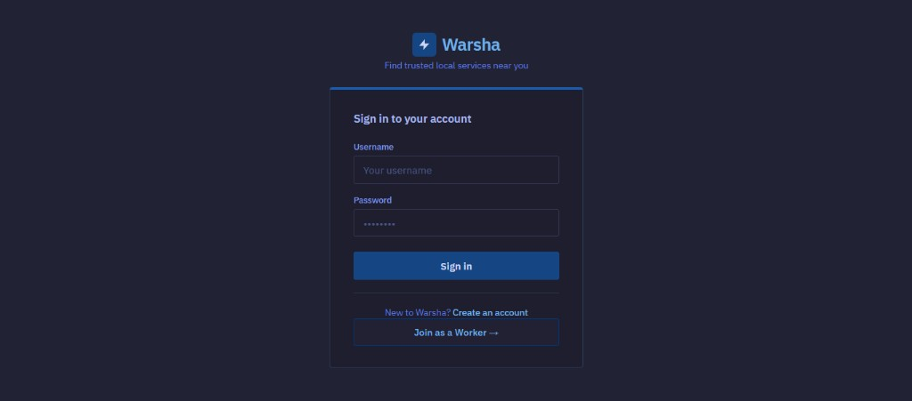
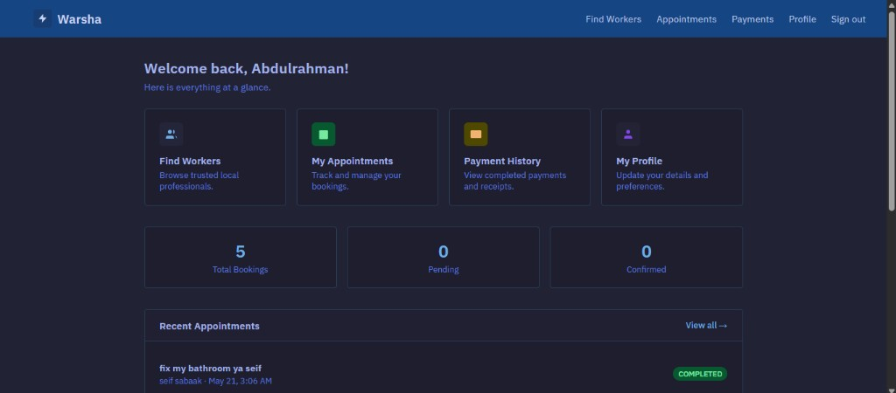
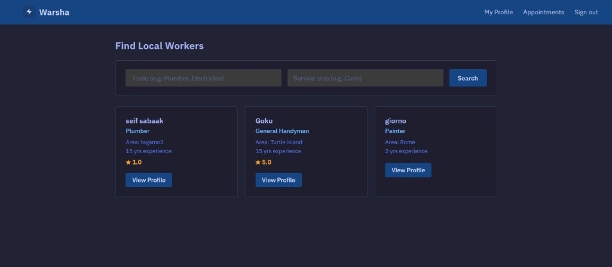
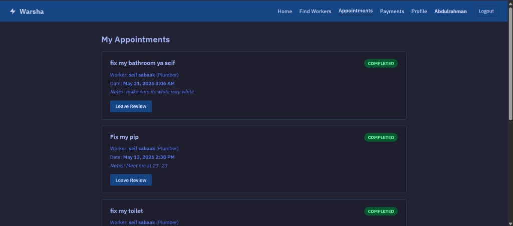
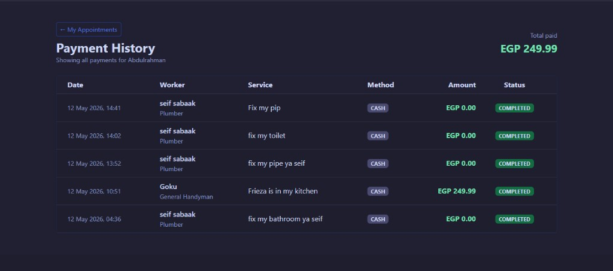
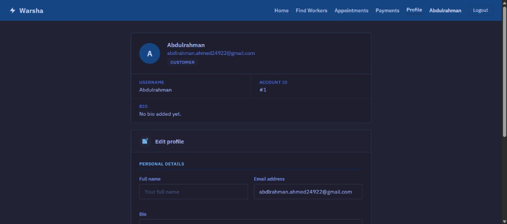

# Warsha , Local Service Finder

Warsha is a web app that connects customers with local service workers — browse providers, book appointments, leave reviews, and track payments/earnings.

## Features

| Role | What you can do |
|------|-----------------|
| **Customer** (`USER`) | Register, browse workers, book/cancel appointments, view payment history, leave reviews |
| **Worker** (`WORKER`) | Register with trade & service area, manage profile & pricing, accept/reject/complete jobs, view earnings |

**Out of scope (not implemented):** admin dashboard, OAuth (Google/Apple), real payment gateway integration.

## Tech stack

- **Java 17** · **Spring Boot 3.2** (MVC, Security, Data JPA)
- **Thymeleaf** server-rendered UI
- **MySQL** (`warshaDB`)
- **Spring Mail** + Mailtrap (optional — dev/test email endpoints only)
- **Maven**

## Prerequisites

- Java **17+**
- Maven **3.6+**
- MySQL **8+** with a database created:

```sql
CREATE DATABASE warshaDB;
```

## Setup

All configuration lives in one file:

```
Warsha/src/main/resources/application.properties
```

Copy the example template and fill in your credentials:

```bash
cd Warsha/src/main/resources
cp application.properties.example application.properties   # Linux/macOS
copy application.properties.example application.properties # Windows
```

### Configuration reference

| Key | Description |
|-----|-------------|
| `spring.datasource.url` | JDBC URL — default `jdbc:mysql://localhost:3306/warshaDB` |
| `spring.datasource.username` | MySQL username |
| `spring.datasource.password` | MySQL password |
| `spring.jpa.hibernate.ddl-auto` | `update` — Hibernate creates/updates tables from entities on startup |
| `server.port` | HTTP port — defaults to **9000**; override with env var `PORT` |
| `server.servlet.session.timeout` | Session lifetime — default `30m` |
| `spring.mail.host` | SMTP host (Mailtrap: `sandbox.smtp.mailtrap.io`) |
| `spring.mail.port` | SMTP port (Mailtrap: `465`) |
| `spring.mail.username` | Mailtrap SMTP username |
| `spring.mail.password` | Mailtrap SMTP password |
| `spring.mail.from` | Sender address shown on outgoing mail |

**No other env vars are required.** Auth uses Spring Security form login with server-side sessions (`JSESSIONID`) — there is no JWT secret or OAuth config.

### Database schema

There is no `schema.sql`, Flyway, or Liquibase migration. On first run, Hibernate auto-generates tables (`users`, `appointments`, `payments`, `reviews`) from the JPA entity classes.

## Running the app

From the `Warsha/` directory:

```bash
cd Warsha

# Standard run (requires MySQL running with credentials in application.properties)
./mvnw spring-boot:run

# Zero-config Dev run (uses built-in H2 in-memory DB, no MySQL required):
./mvnw spring-boot:run -Dspring-boot.run.profiles=dev
```

Open [http://localhost:9000](http://localhost:9000).

### Quick test flow

1. **Register a worker** at `/register/worker` (e.g. trade: Plumber, area: Cairo)
2. **Register a customer** at `/register` (use a different browser/incognito window)
3. **Log in as customer** → browse workers at `/workers` → book an appointment
4. **Log in as worker** → dashboard at `/worker/dashboard` → accept → complete the job
5. **Customer** can view payment history at `/customer/payments` and leave a review on completed jobs

### Email (optional)

Email is **not** sent automatically on registration or booking. To test mail delivery after configuring Mailtrap:

- `GET /dev/email/test` — send a synchronous test email
- `GET /dev/email/test-async` — send via the async executor

Both require you to be logged in and redirect back to `/profile`.

## How payments work

Payments are **recorded internally** — there is no Stripe/PayPal or card processing.

When a worker marks an appointment **COMPLETED**:

1. A `Payment` row is created with the worker's `basePrice` (or `0` if unset)
2. Method is set to `CASH`, status to `COMPLETED`
3. The worker's `totalEarnings` is updated

Customers view history at `/customer/payments`; workers see totals on `/worker/dashboard` and `/worker/earnings`.

## Project structure

```
CS4-3/
└── Warsha/                          ← run Maven commands from here
    ├── pom.xml
    └── src/main/
        ├── java/org/tibo/warsha/
        │   ├── controller/          Auth, Appointment, Worker, Payment, Review, Profile
        │   ├── service/
        │   ├── model/               User, Appointment, Payment, Review
        │   ├── repository/
        │   └── config/              Security, Async
        └── resources/
            ├── application.properties
            ├── application.properties.example
            └── templates/           Thymeleaf HTML pages
```

## Key routes

| Path | Description |
|------|-------------|
| `/login`, `/register`, `/register/worker` | Auth |
| `/layout` | Customer home |
| `/workers`, `/workers/{id}` | Browse & view worker profiles |
| `/appointments`, `/appointments/book/{workerId}` | Customer appointments & booking |
| `/worker/dashboard` | Worker dashboard |
| `/worker/earnings` | Worker earnings history |
| `/customer/payments` | Customer payment history |
| `/customer/review/{appointmentId}` | Leave a review |
| `/profile` | Edit profile |

## Screenshots

### Auth & home



### Browse & book



### Account



## License

MIT License — see [Warsha/LICENSE](Warsha/LICENSE).
